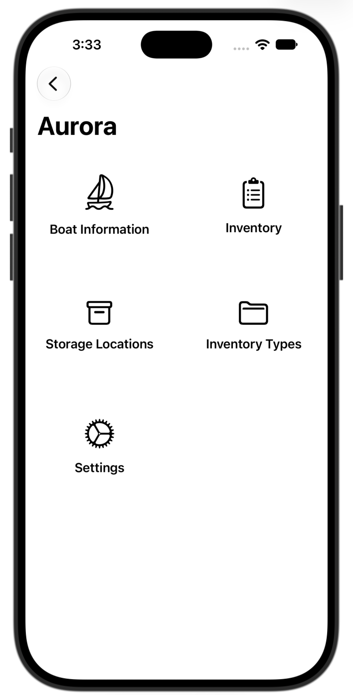
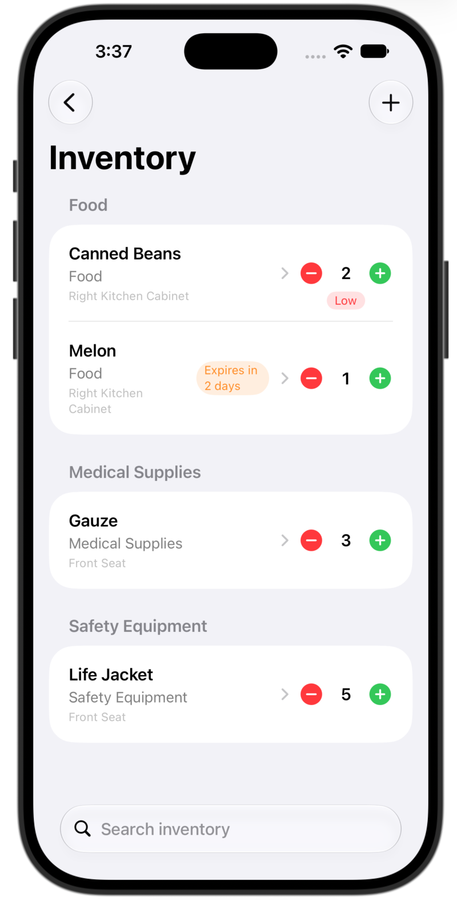
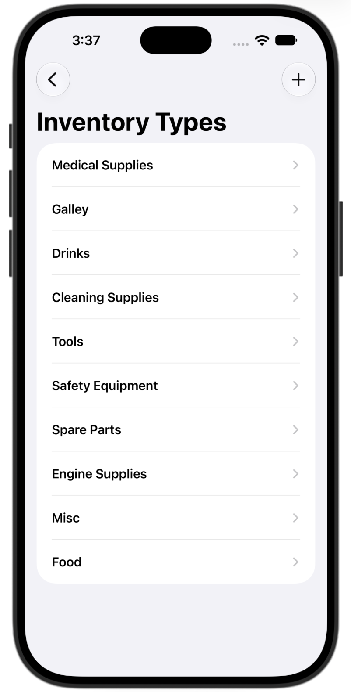

# SailingApp

An iOS app for keeping track of everything on board your boat: what you have, where it's stored, how much is left, and when it expires.

Built with **SwiftUI** and **SwiftData**.

## Screenshots

| Boat Home | Inventory | Inventory Types |
|:---:|:---:|:---:|
|  |  |  |
| Each boat has its own home screen. | Items are grouped by type, with quantity controls and low-stock and expiration tags. | Add, rename and delete categories. The **Storage Locations** page looks the same and works the same way. |

## Features

- **Multiple boats.** Add as many boats as you like and switch between them. Each boat keeps its own inventory, storage locations and inventory types.
- **Boat details.** Record name, make, model, year, engine info, and fuel, water and holding tank capacities.
- **Inventory tracking**
  - Items are grouped by type and can be searched by name, type or storage location.
  - Use the +/− controls on each row to change quantities.
  - A **Low** tag appears when an item reaches its minimum amount.
  - Optional expiration dates, with **Expired** and **Expires in N days** tags.
  - Free-form notes on each item.
- **Storage locations.** Create your own locations (e.g. "Port locker", "Under V-berth") and assign items to them.
- **Inventory types.** Every new boat starts with a default set of categories (Safety Equipment, Tools, Spare Parts, Engine Supplies, Cleaning Supplies, Galley, Food, Drinks, Medical Supplies, Misc). You can add, rename or delete them.
- **Settings.** Choose how many days ahead (1–30) the expiration warning starts.

All data is stored on the device with SwiftData.

## Requirements

- Xcode 26 or later
- iOS 26.5 or later (iPhone and iPad)

## Getting Started

```bash
git clone https://github.com/davey-meredith12/SailingApp.git
cd SailingApp
open SailingApp.xcodeproj
```

Choose a simulator or a connected device, then build and run (⌘R).

To run on a physical device, select your own development team under **Signing & Capabilities** and, if needed, change the bundle identifier.

## Project Structure

```
SailingApp/
├── SailingAppApp.swift        # App entry point, SwiftData container, BoatStore
├── ContentView.swift          # Root view (boat list)
├── AddItemSheet.swift         # Reusable "Add" sheet wrapper
├── Models/
│   ├── Boat.swift             # Boat + default inventory types
│   ├── InventoryItem.swift    # Item with amount, low-stock and expiration logic
│   ├── InventoryType.swift
│   └── StorageLocation.swift
├── Forms/                     # Edit forms shared by the add and detail views
│   ├── BoatForm.swift
│   ├── InventoryItemForm.swift
│   ├── InventoryTypeForm.swift
│   └── StorageLocationForm.swift
└── Views/
    ├── Boat/                  # Boat list, add boat
    ├── Page/                  # Per-boat home grid
    ├── Inventory/             # Inventory list, row components, add item
    ├── StorageLocation/       # Storage location list, add location
    ├── InventoryType/         # Inventory type list, add type
    └── Settings/              # App settings
```

### Data Model

```
Boat ──┬── InventoryItem   (cascade delete)
       ├── StorageLocation (cascade delete)
       └── InventoryType   (cascade delete)

InventoryItem ──> StorageLocation (optional)
InventoryItem ──> InventoryType   (optional)
```

When you delete a boat, all of its items, locations and types are deleted with it. When you delete a storage location or inventory type, the items that used it are kept and simply lose that assignment.

The selected boat is held in an `@Observable` `BoatStore` that is passed through the SwiftUI environment.

## Roadmap

Ideas for future work:

- [ ] Shopping / restock list built from low-stock items
- [ ] Expiration notifications
- [ ] iCloud sync between devices
- [ ] Maintenance log

## Author

David Meredith ([@davey-meredith12](https://github.com/davey-meredith12))
